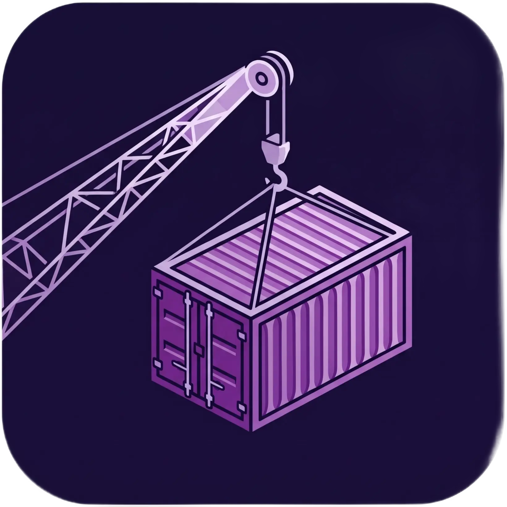
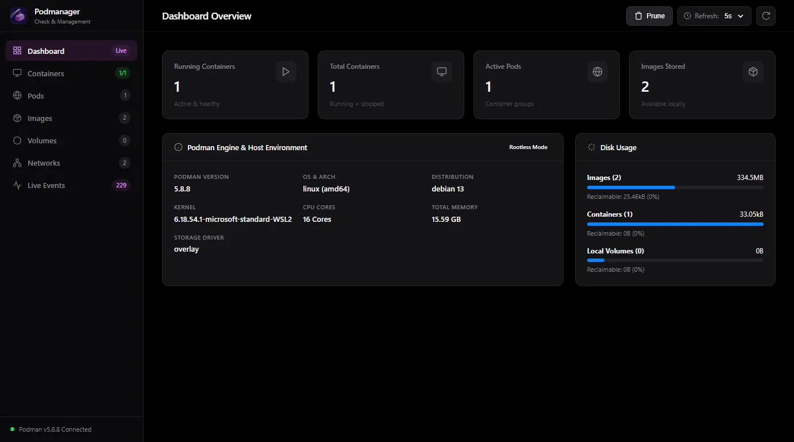

<p align="center">
  
</p>

# Podmanager

The lightweight, native, and modern web app for podman environments.

[](#-key-features)
[](#-quick-start)
[](docs/ARCHITECTURE.md)
[](#-why-podmanager)
[](LICENSE)



## 📖 Overview

**Podmanager** is a sleek, responsive, and production-ready web interface designed specifically for [Podman](https://podman.io/). It empowers developers and system administrators to inspect, manage, and monitor containers, pods, images, volumes, and networks with speed and precision.

Unlike traditional container dashboards designed around Docker daemons, **Podmanager embraces the Podman philosophy**:
- Works natively with **rootless** containers without privileged root access.
- Operates directly via the Podman CLI without requiring complex systemd user sockets or persistent background daemons.
- Delivers a lightning-fast single-page interface with **zero frontend build overhead** and a footprint under **30 MB RAM**.

## ⚡ Why Podmanager?

| Feature                           | Podmanager                         | Portainer                       | Cockpit-Podman            |
| :-------------------------------- | :--------------------------------- | :------------------------------ | :------------------------ |
| **Native Rootless Podman**        | ✅ Native                           | ⚠️ Complex socket setup          | ✅ Native                  |
| **Native Pods Support**           | ✅ First-class                      | ❌ Docker focused                | ⚠️ Basic                   |
| **Zero Socket / Daemon Required** | ✅ Direct CLI execution             | ❌ Requires Docker/Podman socket | ❌ Requires cockpit-bridge |
| **Resource Footprint**            | ⚡ **< 30 MB RAM**                  | 🐢 ~150–250 MB                   | 🐢 System service overhead |
| **Real-Time SSE Streaming**       | ✅ Logs, Events & Pulls             | ⚠️ Polling / WebSocket           | ⚠️ Polling                 |
| **In-Browser Container Exec**     | ✅ Instant CLI runner               | ✅ Available                     | ✅ Available               |
| **Build & Setup Overhead**        | 🚀 **Zero build step (Vanilla JS)** | 📦 Heavy React bundle            | 📦 OS package dependency   |

## ✨ Key Features

### 1. 📊 Executive Dashboard & Engine Health
- **Engine Diagnostics**: Real-time breakdown of Podman version, OS, Linux distribution, kernel, architecture, storage driver, CPU cores, memory utilization, and rootless security mode.
- **Resource Summary Cards**: Live counters for running containers, total workloads, active pods, and stored images.
- **Disk Usage Breakdown**: Visual breakdown of storage consumed by images, containers, and local volumes with reclaimable byte estimation (`podman system df`).
- **One-Click Maintenance**: Automated pruning tools to wipe stopped containers, dangling images, unused volumes, or execute a comprehensive system prune.

### 2. 📦 Container Lifecycle & Real-Time Terminal
- **Intuitive Management Table**: Instant search, status filtering (`all`, `running`, `exited`, `paused`), clickable port forwardings, container name, short ID (one-click copy), and uptime.
- **Granular Controls**: Immediate actions to start, stop, restart, pause, unpause, and force-remove containers.
- **Live Logs Streaming (SSE)**: Real-time log streaming using Server-Sent Events with selectable tail depths (50, 100, 500, all lines), toggleable timestamps, and smooth auto-scrolling.
- **Interactive In-Browser Exec**: Execute arbitrary diagnostics and maintenance commands directly inside any running container (e.g., `env`, `ps aux`, `cat /etc/os-release`) with immediate output rendering.
- **JSON Inspector**: View formatted, syntax-highlighted OCI container configurations with one-click clipboard copying.
- **Run New Container Wizard**: Responsive dialog for deploying containers with custom port publications, environment variables (`KEY=VALUE`), volume mounts, restart policies, and auto-pull support.

### 3. ☸️ First-Class Podman Pods
- **Pod Topology Overview**: Monitor multi-container pods, pod state, creation metadata, and inspect all co-located member containers sharing network namespaces.
- **Lifecycle Management**: Start, stop, restart, inspect, or remove entire pods in a single action.
- **Pod Deployment Dialog**: Easily create new pods with custom port publications and shared networking.

### 4. 🖼️ Image Hub & Streaming Pull
- **Image Catalog**: Inspect local images, tags, virtual sizes, image IDs, and in-use status badges.
- **Live Pull Streaming**: Pull public or private images from Docker Hub, Quay.io, or custom registries with **real-time streaming progress logs** directly inside the modal.
- **Quick Deploy**: Launch a new container directly from any image row with prefilled parameters.
- **Image Deletion**: Safely delete unused or dangling images.

### 5. 💾 Volumes & Container Networks
- **Persistent Storage**: Inspect named volumes, storage drivers, filesystem mountpoints, and manage volume lifecycles.
- **Network Management**: View bridge networks, inspect IP subnets, default gateways, and network drivers.

### 6. 📡 Real-Time Daemon Event Stream
- Live stream of all Podman daemon events (`container create/start/stop/die`, `image pull`, `pod lifecycle`) over persistent Server-Sent Events (SSE).

### 7. 🎨 Polished User Experience
- **Adaptive Dark Mode**: Modern Apple-inspired dark aesthetic with custom typography and accent colors.
- **Shimmer Skeleton Loaders**: Zero content flash with smooth multi-line shimmer skeletons across all tables while fetching state.
- **Mobile & Tablet Optimized**: Fully responsive layout featuring adaptive navigation, touch-friendly scrollable dialogs, and sticky subheaders for inspection windows.

## 🚀 Quick Start

### Prerequisites
- **Node.js** v18 or higher
- **Podman** installed and accessible in `$PATH` (rootless or rootful)

### Installation & Launch

1. **Clone the repository:**
   ```bash
   git clone https://github.com/your-username/podmanager.git
   cd podmanager
   ```

2. **Install dependencies:**
   ```bash
   npm install
   ```

3. **Start the application:**
   ```bash
   npm start
   ```

4. Open your browser at:
   ```
   http://localhost:3030
   ```

### Running as a Container with Podman
You can also run Podmanager directly inside a Podman container mounting the host user namespace:

```bash
podman run -d \
  --name podmanager \
  --restart unless-stopped \
  --network host \
  --security-opt label=disable \
  -v /run/user/$UID/podman/podman.sock:/run/podman/podman.sock:ro \
  ghcr.io/your-username/podmanager:latest
```

### Configuration Options
Podmanager supports standard environment variables:

| Variable | Default   | Description                                                      |
| :------- | :-------- | :--------------------------------------------------------------- |
| `PORT`   | `3030`    | HTTP listening port for the web application and API              |
| `HOST`   | `0.0.0.0` | Network interface to bind to (`127.0.0.1` for local-only access) |

Example:
```bash
PORT=8080 HOST=127.0.0.1 npm start
```

## 📚 Documentation

For deep technical details, development workflows, and API specifications, refer to our specialized guides:

- 🏛️ **[Architecture & Security Guide](docs/ARCHITECTURE.md)**: Monorepo design, zero-build frontend, process execution security, and SSE streaming internals.
- 🔌 **[REST & SSE API Reference](docs/API.md)**: Full endpoint definitions, payload schemas, query parameters, and SSE event formats.
- 🤝 **[Contributing Guide](CONTRIBUTING.md)**: Local development setup, workspace commands, coding conventions, and pull request workflow.

## 📄 Community & License

Contributions, feature requests, and bug reports are welcome! Please read our [Contributing Guide](CONTRIBUTING.md) to get started.

This project is licensed under the **MIT License**. See the [LICENSE](LICENSE) file for details.
